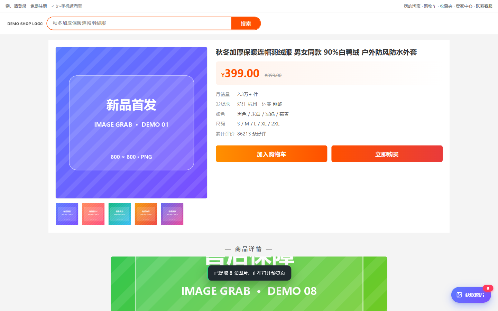
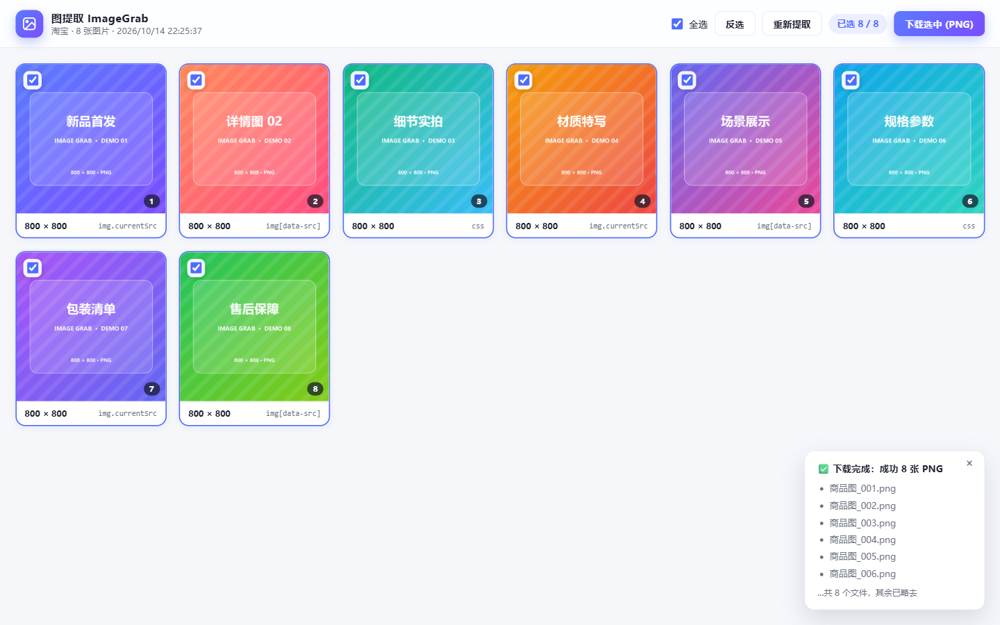
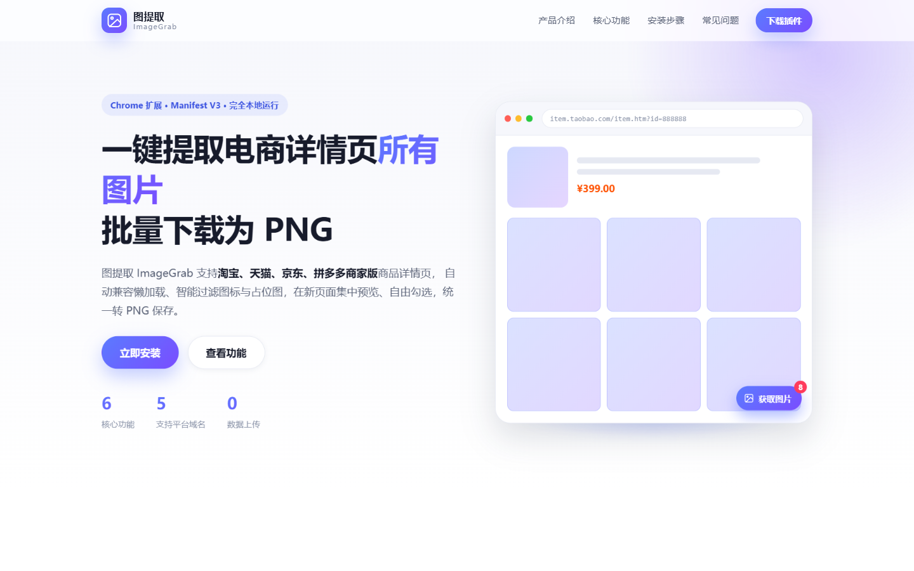

# 图提取 ImageGrab

> 一键提取电商详情页所有图片，批量下载为 PNG 的 Chrome 浏览器扩展。

支持 **淘宝 / 天猫 / 京东 / 拼多多商家版** 商品详情页：点击页面右下角的「获取图片」，
在新标签页集中预览、自由勾选，一键全部保存为 PNG。






**官网首页**（`docs/`，可发布到 GitHub Pages）：



---

## 功能特性

| 功能 | 说明 |
| --- | --- |
| 一键提取 | 自动扫描页面所有商品图，兼容 `srcset`、`data-src`、`data-lazyload`、背景图等懒加载写法 |
| 智能过滤 | 自动排除图标、logo、二维码、占位图与小于 100×100 的图片 |
| 集中预览 | 新标签页网格展示，含缩略图、真实尺寸、来源标记，大图优先排序 |
| 自由勾选 | 全选 / 反选 / 点缩略图切换 / 单张直下，已选数量实时显示 |
| 统一 PNG | jpg、webp、avif 自动通过 `OffscreenCanvas` 转为 PNG |
| 批量下载 | 保存到 `下载/ImageGrab/` 目录，文件名「商品图_001_原名.png」自动编号 |

## 目录结构

```
imagegrab/
├── manifest.json          # 扩展清单（Manifest V3）
├── content.js             # 内容脚本：注入按钮 + 提取图片
├── content.css            # 悬浮按钮与提示样式
├── background.js          # Service Worker：消息转发、PNG 转换、下载
├── gallery.html           # 图片画廊页
├── gallery.css
├── gallery.js
├── popup.html             # 插件弹窗
├── popup.css
├── popup.js
├── icons/                 # 插件图标（16/32/48/128）
├── docs/                  # 官方宣传网站（GitHub Pages 发布目录）
│   ├── index.html
│   ├── css/style.css
│   ├── js/main.js
│   └── assets/favicon.svg
├── demo/                  # 离线演示商品详情页（本地测试用）
└── tools/
    ├── make_assets.py     # 生成图标与演示图片
    └── static-server.js   # 本地静态服务器（带 CORS）
```

## 安装与使用

1. 下载本仓库并解压到本地任意目录。
2. 打开 Chrome，地址栏输入 `chrome://extensions` 回车。
3. 打开右上角的「开发者模式」。
4. 点击「加载已解压的扩展程序」，选择本项目根目录（包含 `manifest.json` 的那一层）。
5. 打开淘宝 / 天猫 / 京东 / 拼多多商家版的商品详情页，先滚动到底部让图片加载出来，
   再点击右下角的「获取图片」按钮。
6. 在自动打开的图片画廊页勾选需要的图片，点击「下载选中 (PNG)」。
   文件保存在浏览器默认下载目录的 `ImageGrab` 子文件夹中。

## 离线自测

```bash
# 1. 启动本地演示服务器（端口 8777）
node tools/static-server.js 8777

# 2. 浏览器打开演示商品详情页
#    http://127.0.0.1:8777/demo/index.html
```

演示页刻意使用了多种懒加载属性（`data-src` / `data-lazyload` / `data-original` /
背景图）与一张 24×24 的小图标，用于验证提取与过滤逻辑。

## 官网预览

官网是纯静态站点，无需构建：

```bash
node tools/static-server.js 8777
# 打开 http://127.0.0.1:8777/docs/index.html
```

也可以直接双击 `docs/index.html` 用浏览器打开。

## 发布官网到 GitHub Pages

仓库已内置工作流 `.github/workflows/pages.yml`，推送后只需：

1. 打开仓库 **Settings → Pages**；
2. **Build and deployment → Source** 选择 **GitHub Actions**；
3. 等 `Deploy docs to GitHub Pages` 跑完，访问
   `https://<你的用户名>.github.io/imagegrab/`。

也可以把 Source 改成 `Deploy from a branch`，分支选 `main`、目录选 `/docs`。

## 隐私说明

插件不请求任何第三方服务器，不上传、不收集任何数据。图片提取、预览与 PNG 转换
全部在浏览器本地完成。

## 权限说明

| 权限 | 用途 |
| --- | --- |
| `activeTab` / `scripting` | 在用户主动操作时与当前标签页通信 |
| `downloads` | 保存转换后的 PNG 文件 |
| `storage` | 暂存本次提取结果与最近几条记录 |
| `tabs` | 打开/复用图片画廊标签页 |
| `host_permissions` | 仅在支持平台的商品页注入按钮、读取图片数据 |

## License

仅供学习交流使用。
